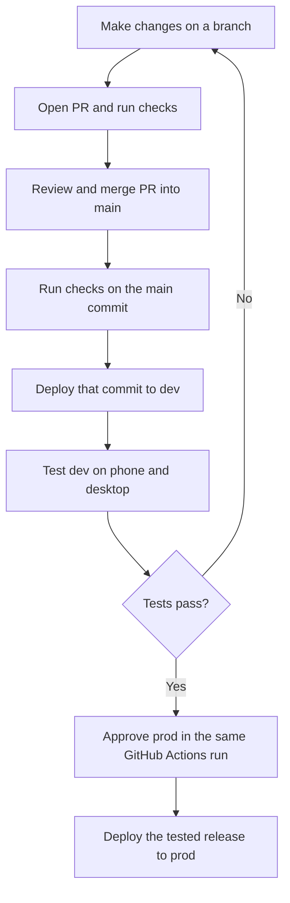

# Test in dev before release

The two environments are **dev** and **prod**. Local development stays on your computer.

| | Dev | Prod |
|---|---|---|
| Site | https://rally-club-app-dev.web.app | https://rally-club-app.web.app |
| Google Cloud / Firebase | rally-club-app-dev | rally-club-app |
| Data | Separate Neon project, synthetic fixtures and test accounts | Real club data |
| Push | Dev Firebase app and dev browser permissions | Production Firebase app |
| Invitation email | No provider key | Existing production provider |
| Deployment | Automatic after checks | Your approval after dev testing |

## The normal workflow

1. Make a change and open a PR as you do now.
2. Review the PR and merge it when its checks pass.
3. Open **Actions > Dev then prod** in GitHub.
4. Wait for the **dev** job to finish.
5. Open the dev site. Check the DEV banner and commit number.
6. Test the changed behavior and the checks below.
7. Return to that Actions run. Select **Review deployments**.
8. Select **prod**. Select **Approve and deploy**.
9. Check the production site after the deployment completes.

You do not need to merge a second release PR. A merge to main does not release to production after this workflow replaces the old deployment workflow. The run waits for your approval. Reject the pending prod job if a test fails. A new fix creates a new dev release and a new approval request.

Only main can release to prod. If you test a PR before merge, its squash merge creates a different commit. Test that main commit in dev before approval.

## Test a branch before merge

After this setup PR is merged, open **Actions > Dev then prod > Run workflow**. Keep the workflow branch set to **main**. Set **source_ref** to the branch name or commit you want to test. The workflow resolves the source to an immutable commit and runs the checks before deployment.

The old automatic PR preview deployment is retired. It used the production Cloud Run service and copies of production data. PRs now run checks and provide instructions for dev testing.

If a PR branch predates this setup, merge the latest main into that branch first. It needs the dev release support before you can deploy it.

Dev is shared. A deployment replaces its previous version. Do not approve an old run after someone deploys a different dev version. The production check rejects approval if dev no longer matches the release artifact. Run the intended source through dev again and repeat the tests.

During setup, pushes to `feat/development-environment` can deploy dev. GitHub restricts dev deployment workflows to this branch and main. The setup branch cannot release to prod. Remove this temporary trigger and its GitHub environment branch policy after setup merges.

## What moves to prod

The backend uses the exact Docker image tested in dev. The run saves the image and its digest as a GitHub artifact. Prod loads the image, verifies the digest, and pushes it into the production registry.

The frontend uses the same source commit. It is built again with production's public Firebase and Auth0 settings. These settings must differ between environments. The `release.json` file records the commit and backend digest. It contains no database credentials.

Each environment runs database migrations before the API deployment. Dev migrations do not change production. Prod runs its own migrations only after approval. This process does not prove a migration works against every historic production row. Review destructive migrations and take a backup before release. App rollback does not undo a database migration.

## Test checklist

- Sign in as the owner. Check the DEV label and the commit number.
- Sign in as a test member. Check pending and approved access.
- Create a session. Check the configurable RSVP deadline and 50-hour default.
- Add and remove RSVPs. Check capacity and waitlist promotion.
- Test a settlement with synthetic members. Check balances and totals.
- Enable push on a test phone and a desktop browser.
- Send a test notification. Check the title, text and destination link.
- Close the app. Send another notification. Open its link.
- Deny permission. Check the app explains how to enable it.
- Test two devices for one account. Check both receive the expected message.
- Test a due reminder with the app closed. Check it sends once.
- Check notification history after a failed send and a retry.

Dev cannot validate SendGrid invitations until a separate dev sender is configured. Do not copy production email credentials into dev. Dev accounts share the Auth0 tenant, but use a separate application and API audience. Club membership and balances remain in separate databases.

## Runtime and cost

The current main version runs reminder checks inside the API. Dev keeps one API instance running with CPU available so those checks can run without browser requests. This has a continuing Cloud Run cost. Dev uses the existing Rally billing account. Neon uses a separate database project with a small endpoint that can suspend when idle.

The pending durable-notification PRs replace the in-process scheduler with a private worker. When the worker source is present, the release script deploys the private worker before it enables queued delivery. Production then also requires its scheduler and worker runtime identities in the repository variables. Do not resolve a deployment workflow conflict by restoring automatic production deployment.

## Setup configuration

Set `DEV_ADMIN_EMAIL` in the `dev` GitHub environment to the verified Google email address of the dev owner. The current dev owner is `chejerlakarthik@gmail.com`. This setting is separate from the production owner. A new verified account with this address receives admin access on its first sign-in. An account that already has pending membership needs approval and an admin role grant.

The `dev` GitHub environment uses `DEV_*` variables for its WIF provider, Auth0 settings and public Firebase settings. Missing settings stop deployment. It never uses production Auth0 or Firebase values as a fallback. Create a separate empty Neon project named `Rally Dev` in the Neon console. Do not create a branch of production. Add its project ID as `DEV_NEON_PROJECT_ID` in GitHub's `dev` environment. Store a key restricted to that project as `DEV_NEON_API_KEY` in the same environment. The default database and role are `neondb` and `neondb_owner`. Set `DEV_NEON_DB_NAME` and `DEV_NEON_DB_ROLE` if they differ.

Run **Set up dev database** once before the first dev release. It reads only the separate dev project and saves its URI in the dev Secret Manager. Normal releases do not receive a Neon administration key. The production project ID is explicitly forbidden. A changed saved project ID requires review before setup can continue.

Until this setup PR merges, the existing `production-api` environment also requires approval. This prevents automatic production releases through the old workflow.

`prod` requires review by `karthik-chejerla-hai`. Administrator bypass is disabled. Only the main workflow branch can enter prod. The maintainer can approve a run they started, which permits a single-owner release process.

Repository administrators can still change workflows, credentials and environment protection. The approval gate protects this release workflow. Review changes to `.github/` with the same care as application changes.

## Dev service access

The dev deployment account has these project roles: Cloud Run Admin, Artifact Registry Writer, Firebase Hosting Admin, Firebase Viewer, Service Usage Consumer, Cloud Scheduler Admin and Secret Manager Admin. It can act as the dev runtime and dev scheduler service accounts. These grants apply only to `rally-club-app-dev`.

The dev runtime can send Firebase messages and read dev secrets. GitHub uses short-lived Workload Identity Federation. The provider accepts only this repository's `dev` environment subject. GitHub branch rules permit main and the temporary setup branch. No service-account key was created.

The dev Auth0 application is `rally-club-app-dev`. Its API audience is `https://rally-club-api-dev`. Callback, logout and web-origin lists contain only `https://rally-club-app-dev.web.app`. User-delegated API access is granted only to the dev SPA. Production's sign-in application and API are unchanged.
